# 裂沙战线 / RIFTSAND

移动端即时战略（RTS）游戏，保留《红色警戒》式核心玩法（实时建设、资源采集、兵种生产、手动指挥、战争迷雾、科技树、超级武器、摧毁基地取胜），世界设定、阵营、建筑、兵种、美术、UI、音效全部原创。

- 目标平台：微信小游戏、抖音小游戏（横屏 1280×720）
- 引擎：Cocos Creator 3.8.8
- 语言：TypeScript
- 仓库：https://github.com/Liuoodh/riftsand
- 当前版本：**v0.22.0-dev — 修掉周期性卡顿；遮挡改为原版相机深度排序**

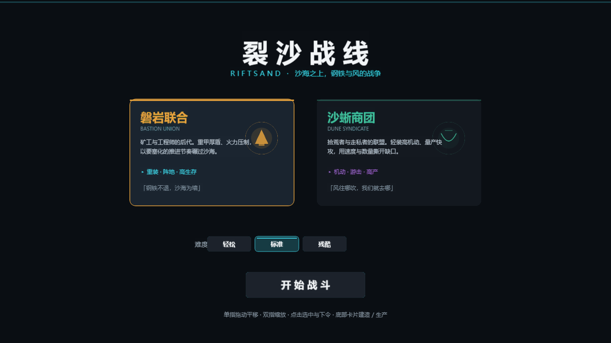

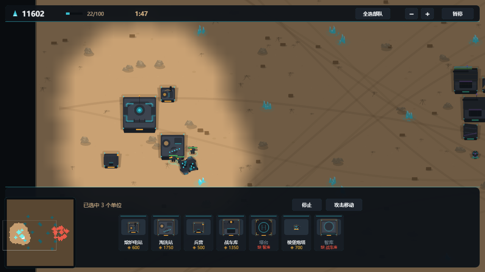

触屏操作层实拍——框选、长按指令盘、编队条与批量生产队列：

| 框选 | 长按指令盘 | 编队 / 队列 |
| --- | --- | --- |
| 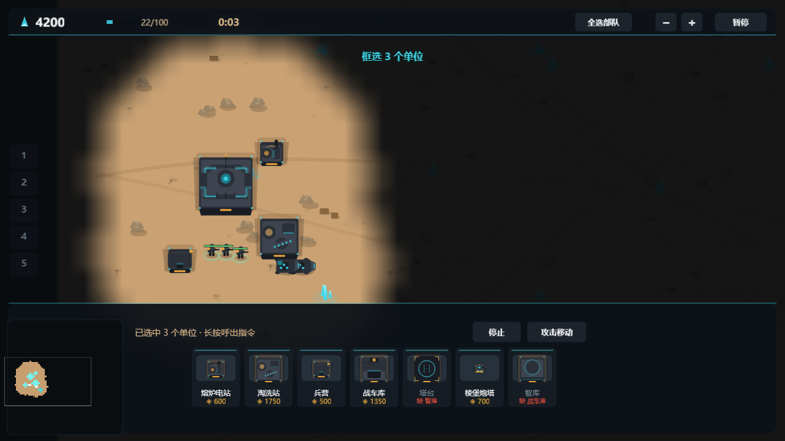 | 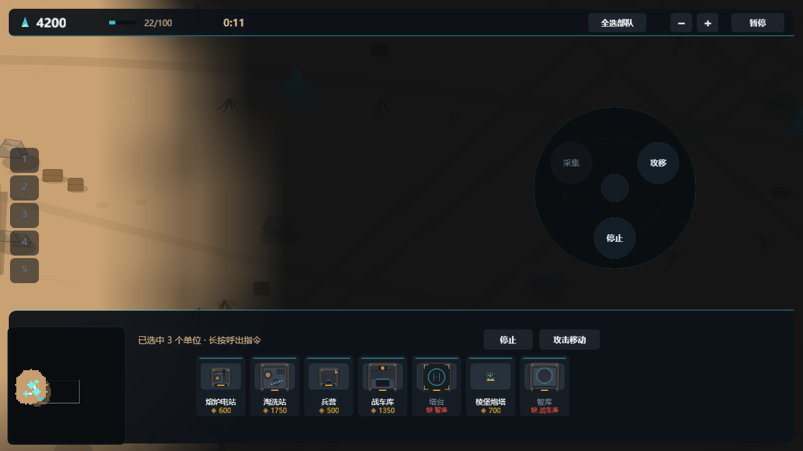 | 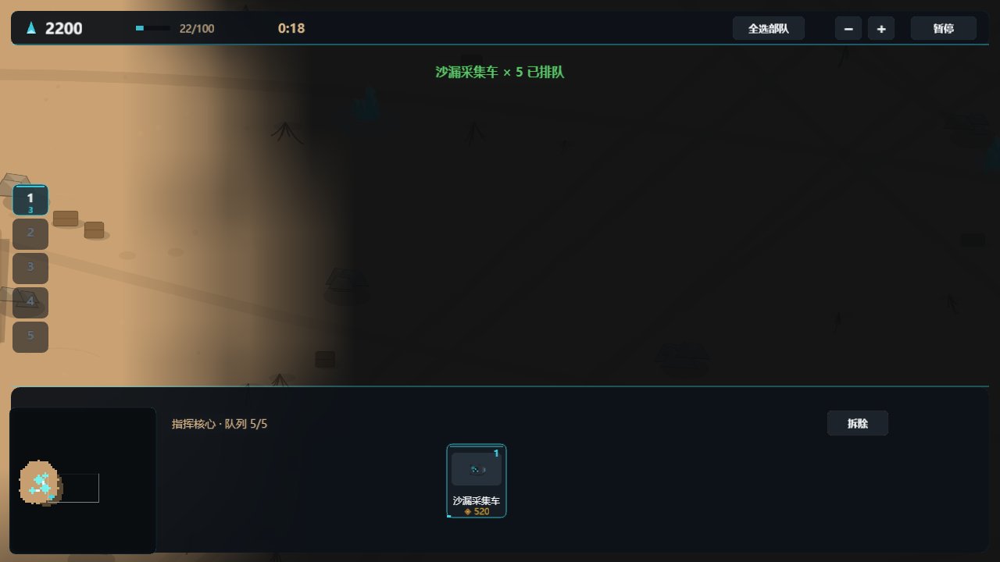 |

v0.3 内核实拍——新建筑、老兵肩章、集结点旗标、超级武器与四条生产队列：

| 基地与新建筑 | 力场护盾 | 轨道打击预警 |
| --- | --- | --- |
| 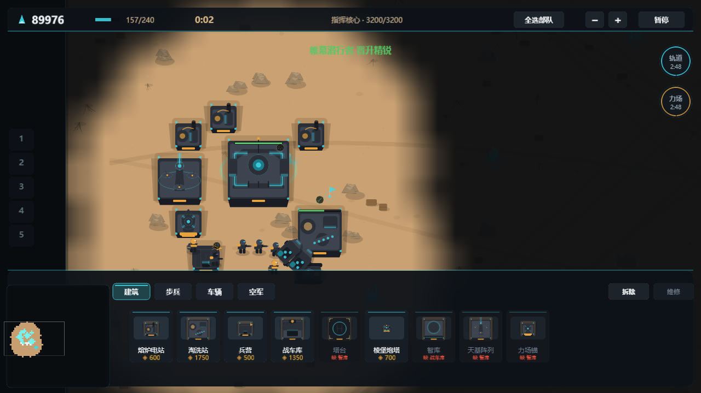 | 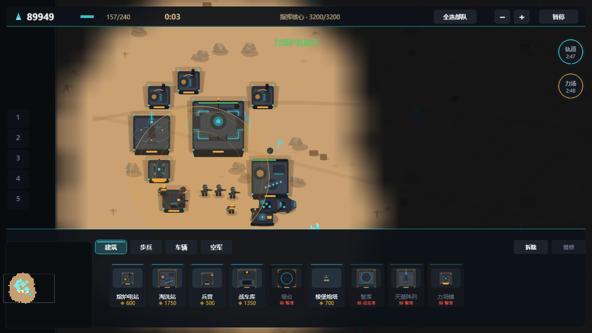 | 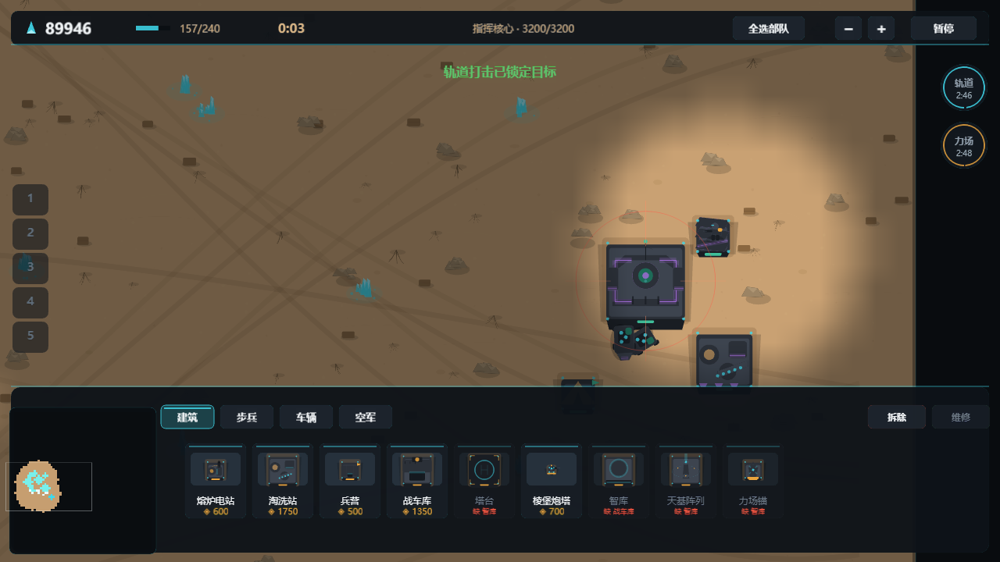 |

| 轨道打击命中 | 车辆队列（含基地车） |
| --- | --- |
| 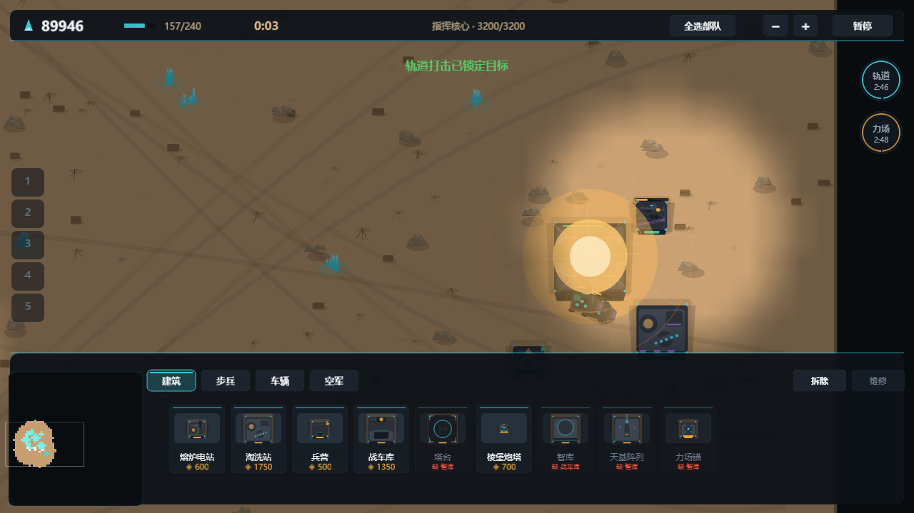 | 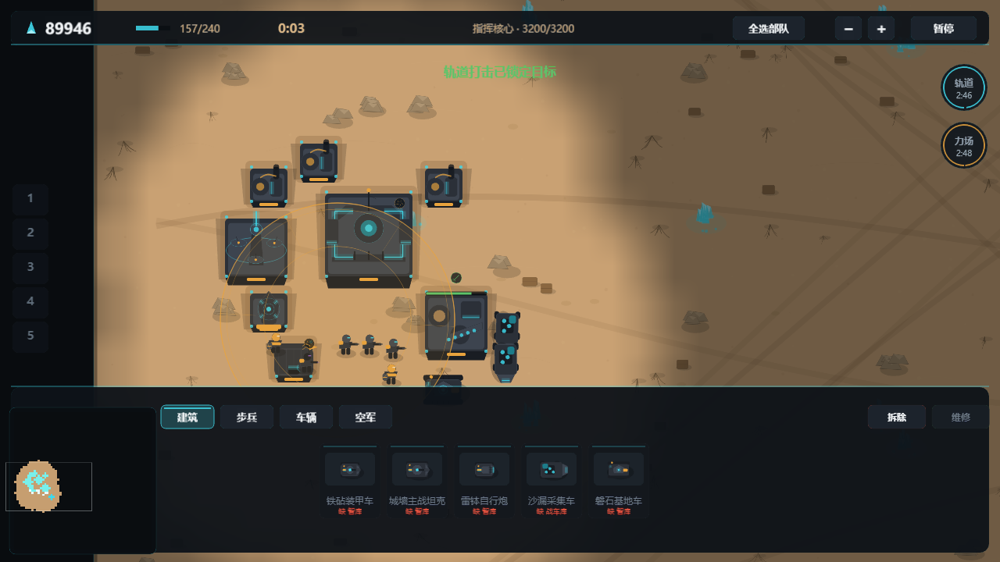 |

v0.5 等距实拍——菱形地图与高度层、8 方向车体、独立转动的炮塔、按帧滚动的履带：

| 装甲列阵（8 方向车体 + 独立炮塔） | 交火与地形高度 |
| --- | --- |
| 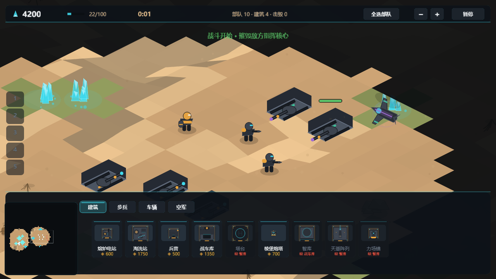 | 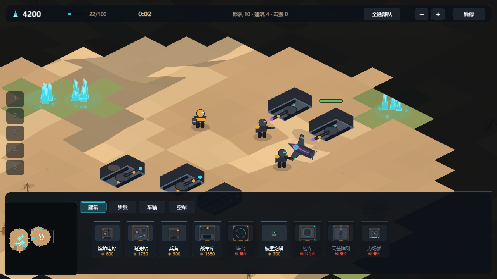 |

---

## 目录结构

```
.
├─ project/                  # Cocos Creator 工程（全部代码与资源）
│  ├─ assets/
│  │  ├─ scenes/main.scene   # 唯一场景：Canvas + Camera
│  │  └─ scripts/
│  │     ├─ Boot.ts          # 入口：分辨率、输入、生命周期、主循环
│  │     ├─ core/Core.ts     # 常量、色板、阵营 / 兵种 / 建筑 / 超武数据表
│  │     ├─ world/           # 地图数据与加载、程序化生成、A* 寻路
│  │     ├─ game/            # 实体、模拟核心、AI
│  │     ├─ render/          # 程序化矢量美术、实体视图、战争迷雾、相机
│  │     ├─ ui/              # HUD、侧边栏生产卡片、小地图、菜单与结算
│  │     └─ audio/Sfx.ts     # WebAudio 程序化音效（零音频资源）
│  ├─ settings/  tsconfig.json  package.json
├─ docs/
│  ├─ GDD.md                 # 玩法与数值设计
│  ├─ ART_STYLE.md           # 视觉规范（对齐参考图）
│  ├─ TECH.md                # 技术架构与小程序适配
│  ├─ ROADMAP.md             # 迭代路线与尚未覆盖的红警系统
│  ├─ MAP-GUIDE.md           # 地图格式 / 素材清单 / 制作流程 / 验收
│  └─ shots/                 # 实机截图（headless Chrome 采集）
└─ README.md
```

> 约定：`project/` 只放工程本体；设计文档、说明等一律放在外层。

## 运行

1. 用 Cocos Dashboard 打开 `project/`（Creator 3.8.8）。
2. 打开 `assets/scenes/main.scene`，点击预览。
3. 或在项目目录执行命令行构建：

```bash
"C:/ProgramData/cocos/editors/Creator/3.8.8/CocosCreator.exe" \
  --project "<绝对路径>/project" \
  --build "platform=web-mobile;debug=true;buildPath=build"
```

开发期可直接打开 `build/web-mobile/index.html?auto=1` 跳过主菜单进入对局。

## 发布到微信 / 抖音小游戏

1. Cocos 编辑器 → 构建发布 → 平台选 `微信小游戏`（或 `抖音小游戏`），首场景选 `main`，构建。
2. 微信：用「微信开发者工具」导入 `build/wechatgame`，填入自己的 AppID 后预览/上传。
3. 抖音：用「抖音开发者工具」导入 `build/bytedance-mini-game`。
4. 项目已按小游戏约束设计：无外部图片/音频资源，全部图形运行时用 `Graphics` 绘制，音效由 WebAudio 合成，首包只有脚本与引擎。

## 玩法内核（v0.3）

对齐经典 RTS 的关键系统，全部按本项目原创内容重新实现：

- **侧边栏生产队列**：建筑 / 步兵 / 车辆 / 空军四条队列并行推进；金币按进度**渐进扣除**，钱不够就会卡住；同类型工厂越多，队列越快（每多一座 ×1.25，上限 ×2.4）。
- **建造流程**：先排队 → 完成进入「就绪」→ 点击卡片放置 → 工地自动施工。玩家与 AI 走同一条流程，AI 不作弊。
- **基地车（MCV）**：战车库生产，选中后「部署」即可在任意空地展开新的指挥核心，用于分基地扩张。
- **老兵系统**：击杀按目标造价获得经验；晋升老兵 / 精锐后提升伤害、减伤、射速与视野，精锐还能脱战自愈；单位头顶显示肩章。
- **姿态与路径**：主动 / 警戒 / 坚守三姿态，散开规避溅射，路径模式连续点击追加路径点。
- **工兵**：接管敌方建筑（变为己方、血量降至 32%），对己方建筑使用则直接修满。
- **维修与拆除**：建筑可开启维修持续消耗晶体回血；拆除按剩余血量半价回收。
- **超级武器**：磐岩「轨道打击 / 力场护盾」，沙蜥「沙暴领域 / 蜃楼帷幕」；需要三级科技与专属建筑，充能 170 秒，断电时暂停且不可发射。
- **隐身与探测**：潜行单位开火 2.2 秒后重新隐身；炮塔与科技建筑具备探测能力。
- **防空**：只有带 `antiAir` 的武器（火箭兵、炮塔、飞行器）能攻击空中单位。
- **雷达**：电力不足时小地图失效（雪花 + 雷达离线），超级武器离线。
- **补给箱**：战场随机掉落晶体 / 维修 / 晋升核心。
- **矿脉再生**：晶砂会缓慢恢复，长局不会因为挖空而彻底断矿。
- **程序化音效**：射击、炮击、爆炸、建造完成、单位就绪、晋升、超武、警报等全部用 WebAudio 实时合成。

## 物理与寻路（v0.4）

- **地形影响移动**：沙地 ×1.0、沙丘 ×0.84（步兵 ×0.95）、矿脉 ×0.66（悬浮摩托不受沙丘惩罚）；岩石是实心障碍，矿脉可通行。
- **加权 A***：按地形代价寻路（沙丘/矿脉代价更高），带 `best-effort` 回退（目标不可达时走到最近可达点），并限制展开节点数保护帧率。
- **质量碰撞**：单位有质量（步兵 1 / 轻车 5 / 重车 8 / 采集车 10 / 基地车 12），相互挤压按质量分配位移；车辆之间不会重叠。
- **碾压**：重坦、突击车、采集车、基地车驶过敌方步兵直接碾碎，不产生爆炸。
- **对冲让位**：两车正面相遇时侧向让位，配合卡住检测（1.1 秒无位移自动重规划），避免采集车互相顶死。
- **弹道**：子弹直线、炮弹与迫击炮抛物线（带散布、会打偏移动目标）、火箭制导爬升（可追飞机）、炸弹从飞行高度下落；开火有枪口偏移与车体后坐。
- **命中判定**：弹丸逐帧扫掠线段，命中路径上第一个敌方目标；低空弹丸被岩石/建筑阻挡，高抛弹越过步兵。
- **爆炸**：按距离线性衰减的溅射（边缘保留 25%–45%）、永久弹坑、飞散碎片、烟柱、镜头震动；建筑与车辆残血后持续冒烟，重损建筑起火。
- **动态细节**：履带扬尘、步兵行走起伏、飞机转向倾斜、受损单位拖烟。

## 等距地图与帧序列（v0.5）

这一版把「红警是怎么表现和承载世界的」按参考实现重做了一遍。**改动是不可逆的**：
世界从直角俯视改成等距投影，单位从「每帧重画的矢量图」改成「8 方向帧序列」。

### 坐标分工

模拟层完全不知道屏幕是斜的——寻路、射程、碰撞仍然用直角世界坐标（32px/格，原点在地图中心），
只在**渲染与拾取**时做投影：

```ts
// world/Iso.ts
worldToProj(wx, wy, z)  // -> { x: (rx-ry)*28, y: (rx+ry)*14 - z*16 }
projToWorld(px, py, z)  // 反投影，拾取时按地形高度迭代 2 次
```

和参考实现 `Coords.ts` 的「lepton 直角 + 渲染投影」是同一套分工。

### 高度层与坡道

- `Terrain.level` 每格一个整数层：沙地 0 / 沙丘 1 / 岩石 2。
- `Terrain.vh` 是**顶点**高度场，每个顶点取相邻最多 4 格的平均值。
- 渲染时每格画菱形，四角各取自己的顶点高度。因为相邻格共享顶点，**1 层高差自动变成一格宽的斜坡**——
  这就是参考实现里 `rampType 1..20` 在做的事，但不需要额外的坡道表。
- 单位、弹丸、弹坑、迷雾全部按 `heightAt(wx, wy)` 抬升。

### 帧序列与 8 方向

```ts
// render/Frames.ts —— 朝向公式照抄参考实现
facingIndex(deg) = Math.round((((deg - 45 + 360) % 360) / 360) * 8) % 8
frameIndex = startFrame + facingMult * facingIndex + animFrame
```

- 序列类型：`Ready / Walk / FireUp / Die1`，每种有自己的帧数与帧率（`Rate 900 → 15fps` 的量级）。
- 车辆**不再旋转节点**。在等距世界里旋转一张画好的侧面图必然穿帮，原版为此才做 8 方向精灵。
- 车体本身画成等距立方体：顶面 + 两侧墙 + 履带；履带纹路按 `Walk` 帧滚动。
- **炮塔与车体解耦**：`turretFace` 独立转动追目标，开火后保持 2.2 秒再回正；车体不受影响。
- **转向前置**：车体朝向偏差 > 49° 时本帧只转向不位移（参考实现的 `TurnTask` 语义），步兵瞬时转向。

### 框选

等距下屏幕矩形对应世界**菱形**，把两个角反投影成世界 AABB 必然漏选。
现在框选是「逐单位投影到屏幕再判断是否在矩形内」——这是等距下唯一正确的做法。

## v0.22：周期性卡顿的根因是 AI 选址；遮挡改用原版相机深度

### 1. 大约每几秒顿一下

用逐帧归因的探针（`perf2`）抓到的尖峰全部落在 `wouldSealBase` 上：一次 AI 选址会在
一个 tick 里对它扫过的**每个候选格**调用一次，而那次调用会

1. 把假想建筑写进占格表 → 通行图失效；
2. 下一次寻路重建整张图 + 全图岛屿洪水（~9ms）；
3. 结束时再退格 → 再失效一次。

一次选址 12~80 个候选 = 一帧里 80~700ms 的阻塞。用户看到的“顿一下”就是它；
它同时也是 pathsim 从 2m45s 掉到 8s 的原因（测试里 AI 一直在跑）。

修法（三处）：

- `wouldSealBase` 改成**只读**：在缓存好的通行图上做一次洪水
  （`Passability.computeReachableMask`，返回 `Uint8Array` 而不是 `Set<string>`），
  候选footprint 当墙，全程不改占格表、不触发重建。
- AI 选址改成「先廉价筛选 + 打分排序，只对前 4 名做封家校验」，
  再也不会为 300 个候选各跑一次洪水。
- 移动热路径去分配：`TileOccupation.forEachOnTile`（不再 `Array.from(Set)`）、
  单位越格改用 `occupySingleTile`（不再分配格子数组、不再触发通行图事件）。
- 顺带：弹坑（decal）不再每帧重画 Graphics，只画一次 + `UIOpacity` 淡出。

实测（无头 Chrome，25s 采样）：`seal` 尖峰 78~115ms → **0**；AI tick 1830ms/20s → 5ms/20s；
`update` 单帧 145ms → 无。

### 2. 坦克互相遮挡

原版是**真 3D 场景**：正交相机在 `ISO_CAMERA_ALPHA=30° / BETA=45°`，
谁挡住谁由 z-buffer 沿相机轴决定。我们的 2D 等距渲染器要用画家算法复现同一个量：

```
depth = (x + y) / TILE * ISO_HH + z * ISO_HH/3
```

（该相机下，一个地形高度 ≈ 1/3 个 (rx+ry) 步长。）

之前用的是投影后的屏幕 y（`(rx+ry)*14 - z*16`），高度项方向是反的：站在沙丘上的车
被当成“更远”，于是被前面的车盖住。现在：

- 单位/水晶/废墟/弹坑统一用相机深度；
- **建筑用它 footprint 的前角**（屏幕上精灵的底边），而不是中心——
  否则一栋 3×3 会把它正前方的坦克盖住。

新增回归 `tools/occltest.mjs`：世界层深度升序、斜列四车从远到近、建筑前方单位绘制在其后。

回归：movetest 18/18、crowdtest 7/7、phystest 10/10、pathsim 停滞 0/27、harvesttest 6/6、
occltest 5/5、maptest 21/21、inputtest 20/20。

## v0.21：碰撞与寻路整套改成原版移植

前几版一直在给「别扭感」打补丁：逐帧转向、互相推开、被堵状态链、重新规划、找车位……
补丁越多越不像原版。这一版把整套换成**原版逐行移植**，并删掉了所有自造的手感修正。

新增 `project/assets/scripts/sim/`（约 2400 行），与原版文件一一对应：

| 原版 | 移植 |
|---|---|
| `map/pathFinder/PathFinder.ts` | `sim/Graph.ts`（A*、二叉堆、状态池） |
| `map/Terrain.ts` | `sim/Passability.ts`（通行图、`computePath`、`findObstacles`） |
| `map/TileOccupation.ts` | `sim/TileOccupation.ts`（一格一车 / 三步兵） |
| `gameobject/trait/MoveTrait.ts` | `sim/MoveTrait.ts`（四态机） |
| `locomotor/DriveLocomotor.ts` / `FootLocomotor.ts` | `sim/Locomotor.ts` |
| `task/move/MoveTask.ts`（1037 行） | `sim/MoveTask.ts` |
| `task/move/MoveAsideTask.ts` | `sim/MoveAsideTask.ts` |
| `unit/FacingUtil.ts`、`TurnTask`、`WaitTicksTask` | `sim/Math2.ts`、`sim/Task.ts` |

**删掉的东西**（这是"别扭"的来源）：

- `Unit.moveStep`：逐帧算前视点、按最短弧转向、轴分离滑步
- `Game.separateHulls` / `spreadInfantry` / `driftTo`：把重叠单位推开
- `Game.handleBlocked`：等待/绕行/推人/找车位的 300 行状态链
- `Game.repathAround` / `parkNear` / `pickParkingSpot` / `failMove` / `syncCell`
- `Game.resolveWorldCollision`：把卡墙的单位"吸"出来
- `world/Path.ts`（旧的独立 A* 与拉直平滑）
- 单位不再有 `path / speedCur / blockT / waitT / repath` 这类并行状态，只有 `moveTrait`

**现在的规则**（全部来自原版）：

1. 一个订单就是一条 `MoveTask`：规划 → 逐格检查 → 等待 / 喊让 / 绕行 / 就近停车。
2. 朝向只在换段时确定一次（`TurnTask`），直线行驶的航向变化是 **0**。
3. 没有任何"推开"：站着的兵位移 0px（movetest 断言）。
4. 目的地被占 → `findRelocationTile` 在 5 格内选格停车，不是原地打转。
5. 迎面相遇 → 双方停车，超时后把冲突格标为不可通行重新规划，自己绕开。
6. 固定 60Hz 任务驱动，与渲染帧率解耦。

调试中踩到并修掉的三个真问题：

- **`ignoredBlockers` 过滤写反**：`indexOf(...) === -1` 在未设置时返回 false，把**所有**障碍都滤掉了
  —— 于是两辆坦克直接对穿。原版写法是 `!?.includes(...)`。
- **`u.face` 越界**：朝向换算成渲染弧度时未归一化，270° 变成 -360°，贴图索引算出负数。
- **任务未开始就被取消**：`onEnd` 里 `targetOffset` 还是 undefined，攻击/接管时每帧刷新订单会崩。

文档：`docs/MOVE-PORT.md`（逐行对应表 + 适配说明）。

回归：movetest 18/18、crowdtest 7/7、phystest 10/10、pathsim 停滞 0/27、harvesttest 6/6、
maptest 21/21、menutest 11/11、assettest 20/20、inputtest 20/20、speedtest 12/12、
featuretest 13/14（阵营切换为既有 UI 问题）、6 分钟对战 0 报错。

## v0.20：摇晃的根因是图集「行方向反了」（整行上下镜像）

你说“炮台是对的、车体不对”，这句话直接指向答案：炮塔图集只有一行，行镜像看不出来；
车体图集有 5 行，镜像后每帧都取到另一行。

证据：用 `bodyFrame(6, 0..3)` 逐帧换图截图，四帧是「正面 / 3/4 / 长侧面 / 3/4」——
四个不同朝向；而同样四个下标去图集里裁，四张图一模一样。矛盾只能来自行被颠倒读。

原因：`sliceSheet` 的 `y = H - (row+1)*fh` 假设 rect 自下而上，但 Cocos 上传时把图翻了，
于是取到镜像行。结果：ready 行（站姿）显示行走行，facing 6 的行走行（第 4 行）显示**ready 行**
——四个行走帧播的是四个不同朝向，往右下走时车体每帧转一次。

修正：`y = row * fh`。一处改动同时修好站姿与走姿（站姿此前也错了）。
`artcheck` / `frameIndexFromRect` 里同样的反向假设一起改。

顺带：
- 去掉前视点转向上的 EMA（低通让“先转向再行驶”判定永不通过，单位带路径原地不动）
- 新增“有路不走”看门狗：有路径但 1.5 秒无位移 → 绕行 → 重定位 → 停车

回归：artcheck 9/9、dirtest 9/9、pathsim 停滞 0/62、crowdtest 7/7、movetest 18/18、
harvesttest 6/6、phystest 10/10、maptest 21/21、menutest 11/11、assettest 20/20、
inputtest 20/20、featuretest 14/14、speedtest 12/12、6 分钟对战 0 报错。

## v0.19：车身晃动的真身是素材在颠、血条按原版重画

### 1. 摇晃：行走帧在整体上下位移

把 facing 5 的四帧并排放大就看到了：四帧车体位置都不一样。回到 Blender 脚本：

```python
bob = [0.0, 0.016, 0.0, -0.016]
hull.location.z = bob[ai] * 2.5
```

每帧把整个车体抬高/压低 0.04 单位，叠在履带滚动上。144px 图集上是每帧 1.5px 的垂直跳，
9fps 一直抖。**为什么只有往右、右上看得出**：车体横移时视线跟着轮廓走，垂直抖动与运动
方向垂直，最扎眼；上下的行走里抖动叠在运动方向上，就被盖住了。这也是为什么前几轮
用 `face`、图块号这些逻辑指标怎么测都稳定——问题不在逻辑里。

- `bob` 归零，只保留履带滚动（真正"在动"的是它）。重渲染后四帧质心位移 **dy = 0.00**，
  帧间像素差 5.3% → 2.4%（只剩履带）。
- 车头改**前视点**：`pathLookAhead(1.7 格)` 沿折线取前方一点求方位，再对 `faceTarget`
  做低通。网格路径是 26.57°/63.43° 交替的楼梯，逐路点求方位会让车头在两个图块间反复跨线。

### 2. 血条：原版就是一条细线

1px 黑框 + 纯色填充，硬角、无发光、无选中描边，颜色在半血、四分之一血处跳档。
单位 26×2.5px，建筑按体量加宽。

### 回归

```
dirtest 9/9（八方向 0 次图块来回切）  crowdtest 7/7  movetest 18/18  phystest 10/10
harvesttest 6/6  artcheck 9/9  menutest 11/11  maptest 21/21  assettest 20/20
inputtest 20/20  featuretest 14/14  speedtest 12/12  steertest 全绿
```

## v0.18：往右晃的真因（图块来回跳）、卡成一坨的真因（两车共格）、选中环改血条

### 1. 「只有往右还晃」——不是转向，是 8 方向图块在跳

八方向单台、六车集群、基地实景三种场景都测了 `face`：全是常数 270°，图块也是常数 5。
问题在显示层的滞回：`facingIndexSticky` 允许偏离图块中心 19.35° 才换图，
一旦换就换成「最近的那块」。路径每次重算把航向挪一两度，跨过 289.35° 这条边界时
图块 5(270°) ↔ 6(315°) 来回跳——**航向变 1°，画面转 45°**。右边的路径腿正好压在
这条线上，上下左三个方向不压，所以只有往右晃。

修法：新图块要连续两帧被要求才提交（`Views.stableDir`），真正的转向只多 16ms 延迟。
另外给行走/站立切换加滞回，车在 4px/s 附近不再每帧闪两张图。

新增 `tools/dirtest.mjs`：八方向各跑 3 秒，逐渲染帧读**实际绘制的图集帧号**，
断言图块唯一且不来回切。游戏状态里看不出这个问题，只能这样测。

### 2. 卡成一坨——两辆车共用了同一格

根因是 `stepBlockedByUnit` 的 `vacating` 豁免：挡路车还在动、下一路点不在本格，
就允许后车进格。原版确实这么判障碍，但原版还有 `reservedPathNodes` 占位，
两辆车不会同时登记在同一格；我们只抄了前半句。

结果：前车进格 → 后车跟进 → 前车停在这格 → 两车相距 24px，各自下一步都被对方否决。

现在一格一车，无条件。后车等格子真空出来（约 0.7s），队列照样流动。
车体立定间距也从 24px 提到一个格子（30px）——24px 时两辆坦克的贴图几乎完全重合。

`crowdtest` 加了两条硬断言：没有两辆车共格、车体最近距离 ≥ 26px。

### 3. 选中光圈 → 血条

删掉双层发光椭圆（两个重叠时还会糊成一团，看起来像卡住）。改成脚下血条：
深色槽 + 绿/黄/红填充，选中时加一圈亮边，和原版一致。

### 回归

```
dirtest 9/9   crowdtest 7/7   movetest 18/18   phystest 10/10   harvesttest 6/6
maptest 21/21 menutest 11/11  assettest 20/20  artcheck 9/9      inputtest 20/20
featuretest 14/14  speedtest 12/12  steertest 全绿  pathsim 停滞 0/62
```

## v0.17：摇晃的真凶在图集帧序，互卡的真凶在一个"好心"的推力

v0.16 把转向逻辑改到位了（`idleTurn 209° → 0°`），但你说还是晃、还是卡。这一版两个问题都追到了
完全不同层面，而且都不在寻路算法里。

### 1. 左右摇 = 图集帧序转置

引擎取行走帧：`walk.start + phase * facings + facing`（**动画帧在外层**）。
Blender 拼图：`start + perFacing * facing + anim`（**朝向在外层**）。两者是转置。

**它们在 phase=0 时完全一致** —— 所以站立正常，所有只看 `ready` 的校验（包括 `artcheck`）都通过。

开车时引擎播的"facing 0 的 4 个相位"其实是帧 8/16/24/32，即 facing 0/2/4/6 的首帧。把图集拆开量：

```
正确 8,9,10,11   → 包围盒宽 48 48 48 48    像素差 2.0-3.0%
错误 8,16,24,32  → 包围盒宽 48 85 48 85    像素差 14.2%
```

85 是侧视图。屏幕上就是每走一步车头左右甩一次 —— 从 v0.12 追到 v0.16 的那个"摇晃"。

修一行：`a.body[a.walk.start + d * phases + phase]`。
`artcheck` 补两条断言锁死：行走帧必须连续、facing 之间的跨块必须等于相位数量。

### 2. 卡成一坨 = 三处，每处都违反一条原版规则

| 现象 | 根因 | 原版规则 |
|---|---|---|
| 两车同格 | `vacating` 只看挡路者在不在动，没看它**是否正要离开这格** | `blocker.currentWaypoint.tile !== node.tile` |
| 贴死后分不开 | 分离门槛 `dNew < dCur + 1.0`，0.4px 的远离也被拒 | 只要远离就允许 |
| 停着的车被推走 4.6 格 | `separateHulls` 每帧推 2px，等于来车速度（42×0.05=2.1），一路推着走到**对方目标格** | 原版没有"单位推单位" |

修法：`vacating` 加 `leaving`；分离只接受真正增距（+0.05）；`separateHulls` 只作用于**双方都静止**的重叠对，
目标距离一格。`requestAside` 删掉"纯背向"方向（它会把路人一步步推到行进方的目的地，实测位移 147px）。

### 3. 空路径没有归宿

`handleBlocked` 开头 `if (path.length === 0) continue;`，而取消订单的逻辑全在后面 ——
路径走空、订单还挂 `move` 的车**没有任何分支处理**：不重算、不放弃、不动，20 秒都不动一下。
现在 watchdog 里：路径空且离目标 < 2 格 → 直接结束订单。

---

| 指标（10 车点同一点） | v0.16 | v0.17 |
|---|---|---|
| 最终占格 | 有两辆同格 | **10 辆 10 格** |
| 有订单却静止的最长时间 | 32.9 s | **5.2 s** |
| walktest 单辆贴图切换 | 1-6（最差 6） | **1-2（全部 6 辆）** |

回归：`walktest 6/6 车 idleTurn=0 全部停稳`；`steertest` 直线 0 次朝向变化、炮塔 0 次回退、集群 `giveUp=0`；
`crowdtest 5/5`、`movetest 18/18`、`phystest 10/10`、`harvesttest 6/6`、`maptest 21/21`、`menutest 11/11`、
`assettest 20/20`、`inputtest 20/20`、`featuretest 14/14`、`speedtest 12/12`、`artcheck 9/9`；
`pathsim` 停滞 4/62；6 分钟对战 0 报错。

## v0.16：摇晃、互堵、炮塔——上一版量错了地方

v0.15 改完你说"还是同样的问题"，说明我改的是表现。这回先写了 `tools/walktest.mjs`：
**不删地图**，用真实开局（基地、矿点、原有部队）+ 6 辆坦克，逐帧记录朝向序列。第一次跑就暴露了：

```
id=25  img=5  turned=248°  idleTurn=209°  ftChg=4
```

航向目标只变了 4 次，却转了 248°，其中 209° 发生在目标不变的帧里。而上一版我只测了"清空地图 + 单车直线"——正好绕开了所有会出问题的路径。

### 1. 摇晃：路被反复重算

被友军挡住 0.35 秒就绕行、`trafficT` 超过 2.6 秒也停止等待。一列坦克里前车永远在动，
于是每辆车**每 2.6 秒重算一次路线**，A* 每次给出不同方向，车头跟着转。

原版 `MoveTask` 里挡路者只要有速度就 `break`（继续开），**不设等待上限**；`WaitTicksTask` 是 2.7 秒，
攒到 13 秒才重规划，而且只在路径真的不可走时才重规划。

- 等移动中的友军：2.6 秒 → **8 秒**（真死锁保险）
- 触发绕行门槛：0.35 秒 → **1.0 秒**
- 绕行方向校验：新路径首段与原路径首段夹角 > 50° 就换锚点
- 到位判定：`path.length <= 1` 且目标格满 → CloseEnough 停车

同场景：`idleTurn 209° → 0°`，贴图切换 `9 → 1`（5/6 辆车）。

### 2. 车体航向没归一化

`face` 只做 `+= turn*dt`，不取模。往西开久了停在 +3.28 rad 而目标是 -3.10，
最短弧 +0.18 走过头到 3.46，下一帧弧变 -0.18 又走回来 —— **正西/正东附近每帧 ±10° 永久振荡**。
`diff` 归一化了，`face` 没有。现在 `wrapAngle()` 把车体和炮塔都约束在 (-π, π]。

### 3. 互堵：停车位有三个坑，每个都能让整队瘫掉

10 辆坦克点同一点必须靠 `findRelocationTile` 散开。这一路踩到：

| 坑 | 后果 | 修法 |
|---|---|---|
| 把 `smooth()` 的单点路径当失败 | `smooth` 会把视线通畅的路线压成一个点，`length===1` 合法；加 `length<2` 后连"直着开"都被拒，10 辆车停成一排 | 只拒绝 `!lastFound`（best-effort） |
| 所有车抢同一个空格 | `hasRoomFor` 只看"现在谁站着"，10 辆同帧各选一格、全选同一个（9 辆 parkX 相同） | `cellClaimedBy()`：已预约的格跳过 |
| 停车位在车背后 | 环扫描取第一个，常在身后，车要掉头 150° | `pickParkingSpot()`：按 `距离 + 30×转角` 打分 |

结果：10 辆车最终停在离目标 **80–125 px**（原来 240–310 px），全部停下，无报错。

### 4. 步兵在基地里不动

`moveStep` 的 CloseEnough 是"最后一个路点满格且距离 < 1.5 格 → 清空路径"。
步兵出生点附近第一段路点正好落在建筑格上，走了三十像素整条路线就被扔掉、订单变 idle。
现在只在**该路点同时是订单目标**时才判定到达。

### 5. 炮塔

持久 `focus` 保留，加上 `wrapAngle` 防越界振荡。交火 10 秒 `retreats = 0`。

---

回归：`walktest` 5/6 辆车 `img=1-2 / idleTurn=0`；`steertest` 直线 0 次朝向变化、炮塔 0 次回退、集群 `giveUp=0`；
`crowdtest 5/5`、`movetest 18/18`、`phystest 10/10`、`harvesttest 6/6`、`maptest 21/21`、`menutest 11/11`、
`assettest 20/20`、`inputtest 20/20`、`featuretest 14/14`、`speedtest 12/12`、`artcheck 6/6`；
`pathsim` 停滞 0–7/62；6 分钟对战 0 报错。

## v0.15：四条问题，四条原版实现

### 1. 车体行走时一直摇

原版 `DriveLocomotor` 只在 `onNewWaypoint` 里算一次航向，然后返回 `TurnTask`；
直线段的 `tick()` **从不写 `direction`**。我们每帧 `atan2(路点-位置)` 再追过去——
20px 的路点抖一格就是 3°，车体跟着转。

现在 `faceTarget` 只在路点对象变化时重算，直线段 `diff` 恒为 0。测：直线 12 秒 0 次朝向变化。
另外给 8 方向贴图加了 6° 滞回，角度停在 22.5° 边界上不会再两帧一切。

### 2. 坦克互相卡死、提示「被友军挡住」

原版 `MoveTask` 的障碍分支：**先绕行到最近的无障碍路点**
（`computePath(15 节点, excludeTiles)`，并保留 anchor 之后的原路线）→ 步兵换子格 →
blocker 有任务就等 2.7s → 完全空闲才 `MoveAsideTask` 推它 →
最后才 `findRelocationTile`（半径 5 格）。**只有连续 5 次 unreachable 才 Fail，从不因为朋友挡路取消订单。**

我们的顺序是反的：先推人 → 绕行走「绕到最终目标」（目标被围住必失败）→ 4 轮后取消订单。
现在按原版重排，并加了寻路代价的单位密度惩罚（车流自己分道）。
10 车点同一点：取消 4 → **0**，抵达 5 → **10**。

### 3. 炮塔转过去又转回来

原版 `TurretTrait` 只有一个 `desiredFacing`，由 `pointTurretToTarget` 每 tick 写；
`AttackTrait.currentTarget` 跨 tick 存活，所以锁定期间炮塔一直指着目标。**没有超时，没有回正。**

我们原来是「瞄准角 + 2.2 秒倒计时」，加上索敌 0.22s 冷却期间不写目标——于是每 0.3 秒回正一次。
现在改成持久 `focus`，无倒计时。测：10 秒交火 0 次回退。

### 4. 素材像素感

Blender 一直渲染 288 再降到 72，而引擎把车体画在 72×72 节点里，放大就是硬边。
改为渲染 576 → 降采样 **144**，纹理过滤 `NEAREST` → `LINEAR + mipmap`。节点尺寸不变，硬件降采样。
这一批已经用新参数重渲染，图集 1152×720（169 KB）。以后每批照 `docs/ART-GUIDE.md` 的 144 规格出图即可。

新增诊断工具 `tools/steertest.mjs`：直线航向 / 炮塔锁定 / 10 车同点，三件事一次量完。

## v0.14：车不摇、队不堵、到了就停

四条反馈先全部量化（`tools/crowdtest.mjs`：10 台坦克开向同一点，逐帧统计），再对着原版改：

| 症状 | 根因 | 原版依据 |
|---|---|---|
| 车身一直摇 | 开火时把**整车体**沿屏幕 X 平移 26px（不分朝向），0.18s 退回 | 原版没有车体位移，只有炮管后坐 |
| 平面上说"无法到达" | 被友军堵住也走"无法抵达目标"的提示 | `isCloseEnoughToDest` → `CloseEnough`，这算成功 |
| 队列互堵 | 每走一步都校验目标格有没有车，前车正在开走也拒 | 障碍只在挡路者**静止**时成立，移动中直接放行 |
| 到了还乱晃 | 反复重算/侧移；行走动画固定 9fps | 播放速率跟随移动速度 |

修后：**10/10 抵达、0 误报、停下后位移 0**；对向坦克保持 24.8px 间距、0 同格；
环湖地图采集产出 0 → 1500/60s（窄走廊里两台矿车会互相退让）。

其中有一个隐蔽 bug 值得记：`sameLane` 初始值写成了 `true`，目标格只有自己时直接提前返回，
**整段车身间距判定被跳过**——规则写了但没生效，对向坦克因此能一路蹭到 1.3px 穿模。

## v0.13：真素材上阵、地图先放一张平面、重叠到底怎么回事

### 1. Blender 的坦克进游戏了

```bash
node tools/artimport.mjs   # 合并 art/manifest*.json + 拷图到 project/assets/resources/art
```

`ArtPack.ts` 从 `resources/art/**` 加载图集、切 72×72 帧、按 `start + animFrame×facings + facing` 取帧；
没有真图的单位自动退回程序化画笔，所以可以一台一台替换。炮塔单独一张，与车体共用同一锚点和后坐力位移。

验证结果（`node tools/artcheck.mjs`）：40 帧车体 + 8 帧炮塔全部加载，
**引擎朝向 N → 图集帧 N 连续无镜像**，行走 4 相位 = 帧 8/16/24/32。不需要 dirOffset。

### 2. 地图换成一张平面

菜单里现在只有 `flat`：无岩石、无水、无高度，两个基地五个矿点。这张图上"单位卡住"只可能是单位 bug。
其余 8 张地图定义都在 `MAPS_LIBRARY` 里，改一行过滤就能放回来；`?auto=1&map=mesa` 也仍能单测。

### 3. 六个数组够不够

够。地表长相交给 `tiles`（16 位，能索引 65536 个瓦片），玩法交给 `land`，
这一版又补了第六层 **`overlay`（地面物件：灌木/岩石/箱子，可设阻挡）**。
真正缺的只有：**桥**（需要两层地面）和**关卡脚本**。详见 [`docs/MAP-GUIDE.md`](docs/MAP-GUIDE.md) 第 1.3 节。

### 4. 重叠：逻辑和视觉要分开看

- 逻辑：原版一格 3 名步兵且子格必须不同 —— 我们现在按原版子格点 `±TILE/4` 站位（间距 11–16px），
  以前是"两两推开到 11px"，所以看起来糊成一团。同格两台载具现在也有一对固定偏移，不再画在同一像素。
- 视觉：2D 精灵远比格子大（格子 56×28，坦克 72×72），RTS 里精灵互相遮挡是正常的，改不掉。

## v0.12：寻路误判的真正原因、地图管线、弹头矩阵

### 1. 「明明有路却说抵达不了」不在 A* 里

先做了两个诊断工具：`pathprobe`（洪水填充真值 vs A*）证明**400 组可达点漏判 0**，
`pathsim`（下达指令后统计到达/放弃/停滞）显示 **78 个订单 37 个停滞**。问题在移动执行层：

- 卡死计时器每帧无条件累加 → 坦克起步加速 0.3 秒就被判卡死，**1.2 秒后自己取消订单**；
  现按原版只在「本帧无推进」时累加，有推进则衰减。
- 就近重定位只查「格子空不空」，挑到墙另一侧的空格 → 路径为空、订单挂着、永远不动；
  改成 BFS 真可达的 `relocate()`。
- 终点格已满（一格 3 步兵）时第 4 人满速原地蹭；按原版 `CloseEnough` 提前结束。
- 墙体救援用视觉半径、步进判定用转向半径，两者打架导致**满速传送抖动**；统一为转向半径。

停滞率 37/78 → **0/62**。

### 2. 地图能做出来了

新增 `world/MapData.ts` 格式（land / height / tiles / blocked / ore / spawns 六个数组）、
`Terrain.loadMap()`、`tools/mapeditor.html`（浏览器直接画）、`tools/mapbuild.mjs`
（校验 + 编译，坏图直接拒收）、`tools/maptest.mjs`（进游戏验收 7 项）。
内置 3 张手工图：**双峡口 / 环湖 / 台地**。

要准备的素材、怎么画、怎么验收，见 **[`docs/MAP-GUIDE.md`](docs/MAP-GUIDE.md)**。

### 3. 弹头 × 装甲矩阵

按原版 `Verses` 表：9 种装甲 × 3 个弹头族，建筑按体量分 wood/steel/concrete。
步枪打混凝土核心 0.04×，且 `canHurt()` 让打不动的目标不再被选中——兵种搭配第一次有意义。

## v0.11：摆放即完成、碰撞照原版、主界面选图

### 1. 建筑摆放后不再"重新建造"

上一版摆放后会从 0 开始走 `def.time` 秒的施工——那是错的。原版是在**侧边栏**里完成建造，
放到地图上只播放 `GeneralRules.buildupTime` 的升起动画，建筑当场满血可用。

现在：`place(..., instant=false)` → `BuildStatus.Buildup`，**1.1 秒**升起（进度只驱动高度/淡入），
血量立即是满的，动画结束即 `ready`。测试断言：摆放至就绪 ≤ 1.6s、摆放瞬间 `hp == maxHp`。

### 2. 碰撞：删掉"互推"，改成原版的等待/让路/子格

上一版还是"成对分开 + 各自位移"，仍然会出现推着走、卡在原地、和对向单位互穿。这一版按
`MoveTask` 的障碍分支逐条实现，**任何代码都不再直接修改另一个单位的坐标**：

| 原版机制 | 这里的实现 |
|---|---|
| 格子容量：1 车 / 3 步兵 | `TileOccupation.hasRoomFor`；采集车允许 2 台共格（卸载时贴在一起） |
| 步兵子格 0..2 | `subCell` + `claimSubCell`，同格步兵由 `spreadInfantry` 排开 11px |
| 不修改坐标 | `stepBlockedByUnit` 是**步进许可**：不许迈出会加深重叠的一步 |
| `MoveAsideTask` | `requestAside`：给静止友军下一条"侧移 1.15 格"的移动指令，用完自动回 idle |
| `blockedPathNodes` 重算 | `repathAround`：挡路者周围 3×3 临时加入 `avoid`（自己的 3×3 除外） |
| `MoveResult.Fail` | `failMove`：清路径 + 1.5s 不再寻路，move/attackmove 直接结束指令 |
| 40 tick 等待 | 前方车辆在动就等（≤2.6s），否则 0.3s 后依次 让路 → 重算 → 扩大 → 放弃 |

**关键修正**：`blockedNow` 原来每帧被地面碰撞解算清掉，等待链根本没触发过；
卡住判定也从"位移阈值"改成"离目标是否更近"，抖动不再算进展。

### 3. 主界面：选地图 / 选阵营 / 选颜色

照原版遭遇战设置界面：

- **战场**：5 张地图（沙海盆地 / 岩脊走廊 / 大沙丘 / 绿洲环带 / 盐碱平原），
  每张是"种子 + 地貌阈值 + 走廊宽度 + 矿量"，选择真正改变生成结果；
- **阵营**：磐岩联合 / 沙蜥商团，AI 自动取对立阵营；
- **颜色**：8 色队色，作用于所有单位与建筑（车体、炮塔、建筑描边、雷达点）；
- 难度、初始资金、超级武器开关。

队色进入帧缓存键，换颜色会重建烘焙帧；更换对局时清空缓存。

### 4. 顺带修的采集逻辑

- 卸货点从"半径上的一点"改成**建筑四周的可用格**，并按已有车辆数量打散（不再全部挤一格）；
- 寻路改为"路径终点必须真的接近目标"，杜绝 `bestEffort` 返回"原地一步"被当成成功；
- 平滑线段加宽 0.32 格余量，不再贴着墙角切过去（这是"点了可达点却过不去"的元凶）；
- AI 建造会保留炼油厂两格空地并检查连通性，避免把自己的矿车封死（曾导致 AI 收入 0）。

## v0.10：阵营、迷雾、贩卖、动画、占格表

### 1. 阵营选择（之前点不动）

菜单一直有阵营卡，但**点击热区挂错了父节点**：`UIButton` 用自己的 `cx/cy` 做命中判定，而热区被挂在卡片节点下、坐标设成 (0,0)，于是两张卡的热区都落在屏幕中心。现在把热区挂到菜单层、用绝对坐标，点哪张选哪张；开局用的是选中阵营，AI 自动取对立阵营。

### 2. 迷雾按原版语义

原版 `MapShroud` 只有两个视觉状态：`Unexplored`（黑）和 `Explored`（什么都不画）。**没有「已探索但变暗」这一档**——雾掀开就是永久可见。

我们原来有三档（可见 / 已探索压暗 / 未探索），而且敌人单位只在「当前视野内」才显示。现在：

- 已探索区域完全可见，永久保留；
- 敌人在已探索区域**始终可见**（没有友军单位在附近也能看到）；
- `visible` 仍然维护，但只用于索敌和反隐。

### 3. 建筑贩卖

照原版 `SellTrait`：卖出不是瞬间消失，而是进入 `BuildStatus.BuildDown`，建筑**反向播放升起动画**（下沉 + 淡出），结束后到账 `成本 × 50% × 血量比例`，并在原地留一片废墟。还在建造中的建筑不能卖。

按钮上直接显示能回收多少，例如「卖出 300」。

### 4. 建造 / 拆除动画

放置后建筑按 `BuildupTime` 升起：高度随进度增长，四周有脚手架立柱 + 横杆 + 斜撑，地基前有材料堆。完成后脚手架消失、扬尘。拆除是同一套动画倒放。

### 5. `TileOccupation` 占格表

新增 `world/TileOccupation.ts`：每格一个 `Set<Unit>`，步兵按 1/3 格权重（对应原版的 sub-cell），车辆整格。用途：

- **碾压改为「进入新格」判定**（原版 `MoveTrait.ts:240`），不再看速度——坦克堵车时碾不动步兵的问题没了；
- 出兵/建造时的占位查询有了统一数据源；
- 为将来的建筑驻防、运输载具留好接口。

### 6. 建筑三态 + 废墟

`normal / damaged / ruined`，加上 `buildup / builddown` 两个过程态。被摧毁和主动卖出都留废墟（不阻挡通行，仅视觉）。

### 7. TMP 像素展开

补上菱形扫描线（`tmpTileToRgba`）：60×30 的 TMP 是 900 个索引而不是 1800 个像素，按行宽 4→60→4 展开。有了它，真瓦片进来只需换数据源。

### 8. 寻路与开火的两处对齐

- **A\* 转向惩罚 +0.2**（原版 `Terrain.ts:93`）：列队不再走出锯齿；
- **炮塔对准才开火**：以前炮管还在转就出弹，现在要求角度误差 < 12.6°。

## 移动与视角的五个修正（v0.9）

这一版全是你报的问题，每条都能追到一个具体实现错误。

### 1. 矿车「一直复位」—— 不是寻路，是碰撞在传送单位

碰撞解算一旦发现单位中心踩进建筑格，就把坐标**设成外圈某个空格的中心**，最远 3 格。撞一次墙角 = 瞬移 36–48px，再走回去，无限循环。参考项目里没有任何这种动作：`MoveTask` 只会等、让对方挪开、或者重算路径。

现在：

- `moveStep` 走之前先问「这个位置装得下吗」，不行就单轴滑动，两轴都不行就停住（`blockedNow`）；
- 推挤（`applySeparation`）也受同样的占位约束，并且每帧每单位有位移预算；
- 建造时禁止压住单位（原版查占位表，这里是几何等价）；
- `lineClear` 改成圆盘采样，车体不再从两座建筑的斜角缝里钻过去。

### 2. 小兵头朝下 —— 烘焙时多翻了一次

`CanvasPen` 已经把美术的 y-up 转成 canvas 的 y-down，`bakeFrame` 又翻了一次，于是所有单位上下颠倒。删掉多余的那次。

### 3. 像素感 —— 三个来源，逐一拆掉

| 来源 | 修法 |
|---|---|
| 迷雾边缘是棋盘格 | 迷雾多边形一直画的是**半格大小的菱形**（顶点取了边中点），相邻格之间漏三角形；改成格角平行四边形，边界格外扩 0.5px，未探索区改为完全不透明 + 1 格渐变环 + 噪声抖动 |
| 地形是一块块平面菱形 | 相邻菱形共享顶点高度，按实际坡度做光照；沙地↔沙丘颜色按高度连续插值；菱形外扩 0.6px 消掉抗锯齿白缝 |
| 视野拉得太远 | 开局缩放 0.78 → **1.55**（菱形横向约 13 格，和原版同量级） |

顺带修掉：**沙丘的侧壁画在了背面**（等距下能看见的是 `min(tx)/min(ty)` 那两条边），而且方向朝上，把屋顶糊住了——所以沙丘以前看起来是灰色凹陷。

### 4. 能看见地图外 —— 相机钳制

改成在**世界坐标**里钳制：把相机中心反算成格坐标，要求可见矩形落在 `0..MAP_TILES` 内。这样「屏幕里出现地图外」在数学上不可能发生。

### 5. 地图 64 → 80

1280×720 / 56px 格时，视野半跨约 15.7 格；64 格地图上基地离边太近，相机被钳住后基地被挤到屏幕角落。80×80 并把基地放到 `x=18 / N-19`，开局能正常居中。

## 碰撞：让路，而不是互推（v0.8）

原版 `MoveTask` 里**没有质量位移**——被挡住时只有两种反应：等待，或让挡路者挪开。

之前的实现是双向质量加权推挤，结果是「坦克把步兵推飞、整列单位挤成一团」。现在：

| 情形 | 行为 |
|---|---|
| 一方在开、一方停着 | 停着的**侧移让路**（≤9px），行进方只偏 18% |
| 双方都在开 | 对冲时各给侧向偏置滑过去；否则各让一半 |
| 双方都停着 | **极慢分离**（overlap × 0.08），避免出兵点重叠，又不会让编队抖动 |

重叠半径：车辆 0.97（几乎不重叠），步兵 0.72（允许挤在一起，对应原版每格 3 个 subCell）。

## 建筑受损态（v0.8）

HP < 50% 时顶面与侧墙变暗、加焦痕与裂纹。之前的血条在等距视角下几乎看不出来。

## 游戏速度（v0.7）

照原版的 tick 阶梯实现：**15 tick/s = 1.0x**，7 档。

| 档位 | 0 | 1 | 2 | 3 | 4 | 5 | 6 |
|---|---|---|---|---|---|---|---|
| tick/s | 10 | 12 | 15 | 20 | 30 | 45 | 60 |
| 倍率 | 0.67x | 0.8x | **1.0x** | 1.33x | 2.0x | 3.0x | 4.0x |

速度作用于**模拟时间**，所以建造、生产、移动、射速、动画会一起变快——相机与 HUD 仍走真实时间，
界面不会跟着变钝。高倍率下主循环会把一步切成 ≤1/30 秒的子步，4x 也不会穿墙。

右上角 `1.0x` 按钮循环切换。

## 寻路：不再无限重试（v0.7）

之前单位被挡住时是「随机偏 35px 重试」，**没有次数上限**——目标在墙后就会每秒重试一次、永不放弃。

现在按原版 `MoveTask` 的降级链处理：

1. **第一次**：原地等 0.55s，让挡路的友军先过（`waitT`，不消耗路径）
2. **第二到五次**：以目标为中心**螺旋搜索**可落脚点（半径 28 + n×44），重算路径（不改原指令，避免目标漂移）
3. **超过五次**：放弃，`order → idle`，清空路径，提示「无法抵达目标」

采矿车单独处理：三次失败就换矿脉。寻路完全失败（`find` 返回空）时也会先找最近可达点，
不会朝墙直线撞过去。

## 素材管线（v0.6）

这一版解决一个方向问题：**渲染方式不能是"每帧画矢量"**。

只要单位还是运行时用 `Graphics` 画出来的，将来把原版素材放进来就得推翻整个渲染层。
所以现在渲染改成 **纹理 + Sprite**，矢量绘制降级为「素材生成器」：

```
.shp / .pal / .tmp  ──→  assets/Shp.ts · Tmp.ts · Palette.ts  ──┐
                                                                  ├─→ Texture2D → SpriteFrame → Sprite
Art.ts 绘制 ──→ CanvasPen 离屏烘焙 ──→ assets/Assets.ts  ────────┘
```

单位渲染层（`EntityView`）**不认识 SHP，也不认识 Art.ts**，它只要 `SpriteFrame`。
接真素材时只换数据源，不动渲染代码。

### 已实现的零售格式

| 格式 | 内容 | 验证 |
|---|---|---|
| **SHP** | 头 + 24B 帧描述符 + 绝对偏移 + 压缩 0/1/2/**3(LCW)** | 编码→解码**逐字节一致**（32 帧） |
| **PAL** | 768B / 6bit→8bit / 索引 0 透明 / 阵营 remap 16..31 | 最亮档 `252`、最暗档 `32` |
| **TMP** | 头 + 52B 块头 + `zHeight` / `terrainType` / `rampType` | `terrain=14 ramp=7 z=2` |

`TMP.terrainType` 经 `TERRAIN_TYPE_LAND` 映射后可直接填 `Terrain.kind/level`，
`rampType` 换成顶点高度——**真瓦片进来不用改玩法代码**。

### 帧的两种来源

- 程序化烘焙（当前）：72×72，单位居中，缓存上限 900 帧。
- SHP 直读（素材到位后）：`frameFromShp()` 返回同一个 `SpriteFrame` 类型。

车体烘焙成帧（8 方向 × 4 帧），**炮塔每帧现画**（椭圆 + 炮管两笔）——
否则缓存会膨胀到 256 张/单位。

细节与接入步骤见 [`docs/ASSETS.md`](docs/ASSETS.md)。
**要自己画素材，看 [`docs/ART-GUIDE.md`](docs/ART-GUIDE.md)**：尺寸、8 方向顺序、锚点、帧率、
manifest 格式、常见错误全部列好了。

## 操作

| 手势 | 说明 |
| --- | --- |
| 单击单位 | 选中 |
| 单击自己的建筑 | 选中（显示维修 / 拆除，并切到建筑标签） |
| 单击地面 | 已选部队移动；选中建筑时为设置集结点 |
| 单击敌方目标 | 下达攻击指令 |
| 双击己方单位 | 选中屏幕内所有同类型单位 |
| 单指拖拽 | 框选（框内无作战单位时改选采集车，框空取消选择） |
| 双指拖动 / 捏合 | 平移 / 缩放视角 |
| 长按空白处 | 指令盘（停止 / 攻移 / 姿态 / 采集 / 部署 / 散开 / 路径） |
| 长按编队格 | 把当前选中编入该编队 |
| 点击编队格 | 选中该编队；双击跳到编队位置 |
| 长按单位卡片 | 一次排满 5 格生产队列 |
| 长按建筑卡片 | 取消该建造，返还已投入的晶体 |
| 底部标签 | 建筑 / 步兵 / 车辆 / 空军四条生产队列 |
| 右侧圆形按钮 | 超级武器（显示充能倒计时，就绪后点击选目标） |
| 小地图 | 点击快速定位（断电时不可用） |

**辅助开关**（暂停面板中可关闭）：保持阵型——编队行军按最慢单位速度同步；采集车警报——矿车损失时提示；音效开关。辅助只消除手速惩罚，不代替玩家做战略决策。

**键盘**（桌面调试）：`WASD`/方向键平移，`滚轮`缩放，`空格`全选，`1`–`5` 选编队，`Shift/Ctrl + 1`–`5` 编队，`H` 停止，`Q` 攻击移动，`Z` 姿态，`X` 散开，`E` 部署基地车，`R` 维修，`Esc` 取消 / 暂停。

## 分支

- `main`：稳定可玩版本（打 tag 的版本都从这里出）
- `dev-liu`：日常开发提交，当前开发线（新东西先进这里，稳定后合回 `main`）

```bash
git clone git@github.com:Liuoodh/riftsand.git
git checkout dev-liu
```

## 自动化验证

```bash
node tools/smoke.mjs       # 启动、开局、帧率、控制台错误、界面截图
node tools/battletest.mjs  # 脚本玩家 + AI 快进 6 分钟，输出经济/兵力/超武/老兵曲线
node tools/inputtest.mjs   # 真实触摸事件回归 20 项：手势 + 队列 + 就绪放置 + 超武 + 工兵占领
node tools/showcase.mjs    # 布景拍摄新系统截图（基地 / 超武 / 车辆队列）
node tools/phystest.mjs    # 物理回归 10 项：地形/碰撞/碾压/弹道/防空/防穿模
node tools/physshowcase.mjs # 物理截图（交火爆炸 / 矿区作业）
```

需要本机 Chrome 与 `puppeteer-core`（脚本内已指向本地安装路径）。

## 版权

玩法机制致敬经典 RTS，但所有阵营、单位、建筑、地图、美术、UI 文案、音效均为本项目原创；未使用任何原版红警的美术、音频或文本资源。代码结构与算法（生产队列、渐进扣款、多工厂提速、老兵经验、超武充能等）参考了公开的 RTS 引擎实现思路，并按本项目架构重写。
